# Visualizing intermediate activations
## First conv2d activation layer outputs -> each image for one feature map of 32
```python
# Model: "functional"
# ┏━━━━━━━━━━━━━━━━━━━━━━━━━━━━━━━━━━━━━━┳━━━━━━━━━━━━━━━━━━━━━━━━━━━━━┳━━━━━━━━━━━━━━━━━┓
# ┃ Layer (type)                         ┃ Output Shape                ┃         Param # ┃
# ┡━━━━━━━━━━━━━━━━━━━━━━━━━━━━━━━━━━━━━━╇━━━━━━━━━━━━━━━━━━━━━━━━━━━━━╇━━━━━━━━━━━━━━━━━┩
# │ input_layer (InputLayer)             │ (None, 180, 180, 3)         │               0 │
# ├──────────────────────────────────────┼─────────────────────────────┼─────────────────┤
# │ rescaling (Rescaling)                │ (None, 180, 180, 3)         │               0 │
# ├──────────────────────────────────────┼─────────────────────────────┼─────────────────┤
# │ conv2d (Conv2D)                      │ (None, 178, 178, 32)        │             896 │  <------ HERE
# ├──────────────────────────────────────┼─────────────────────────────┼─────────────────┤
# │ max_pooling2d (MaxPooling2D)         │ (None, 89, 89, 32)          │               0 │
# ├──────────────────────────────────────┼─────────────────────────────┼─────────────────┤
# │ conv2d_1 (Conv2D)                    │ (None, 87, 87, 64)          │          18,496 │
# ├──────────────────────────────────────┼─────────────────────────────┼─────────────────┤
# │ max_pooling2d_1 (MaxPooling2D)       │ (None, 43, 43, 64)          │               0 │
# ├──────────────────────────────────────┼─────────────────────────────┼─────────────────┤
# │ conv2d_2 (Conv2D)                    │ (None, 41, 41, 128)         │          73,856 │
# ├──────────────────────────────────────┼─────────────────────────────┼─────────────────┤
# │ max_pooling2d_2 (MaxPooling2D)       │ (None, 20, 20, 128)         │               0 │
# ├──────────────────────────────────────┼─────────────────────────────┼─────────────────┤
# │ conv2d_3 (Conv2D)                    │ (None, 18, 18, 256)         │         295,168 │
# ├──────────────────────────────────────┼─────────────────────────────┼─────────────────┤
# │ max_pooling2d_3 (MaxPooling2D)       │ (None, 9, 9, 256)           │               0 │
# ├──────────────────────────────────────┼─────────────────────────────┼─────────────────┤
# │ conv2d_4 (Conv2D)                    │ (None, 7, 7, 512)           │       1,180,160 │
# ├──────────────────────────────────────┼─────────────────────────────┼─────────────────┤
# │ global_average_pooling2d             │ (None, 512)                 │               0 │
# │ (GlobalAveragePooling2D)             │                             │                 │
# ├──────────────────────────────────────┼─────────────────────────────┼─────────────────┤
# │ dense (Dense)                        │ (None, 1)                   │             513 │
# └──────────────────────────────────────┴─────────────────────────────┴─────────────────┘
```
<div style="display: flex; flex-wrap: wrap; gap: 4px;">

  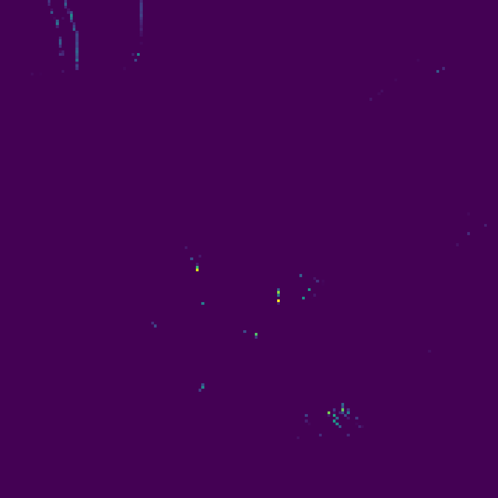
  
  
  
  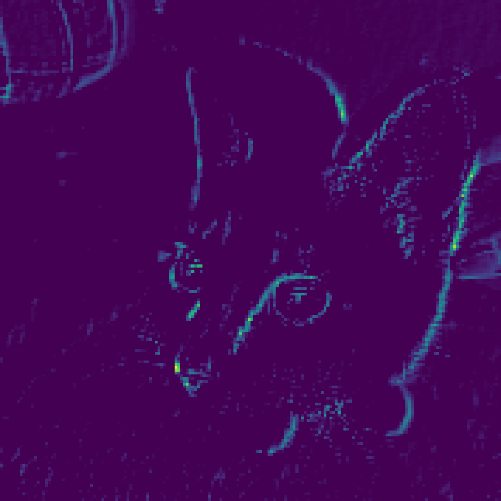
  
  
  

  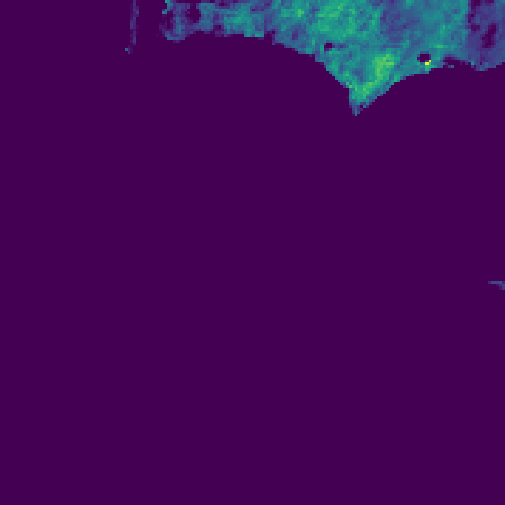
  
  
  
  
  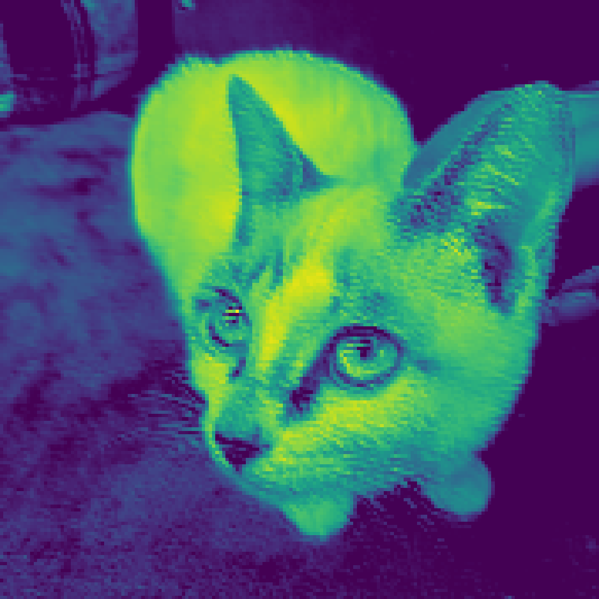
  
  

  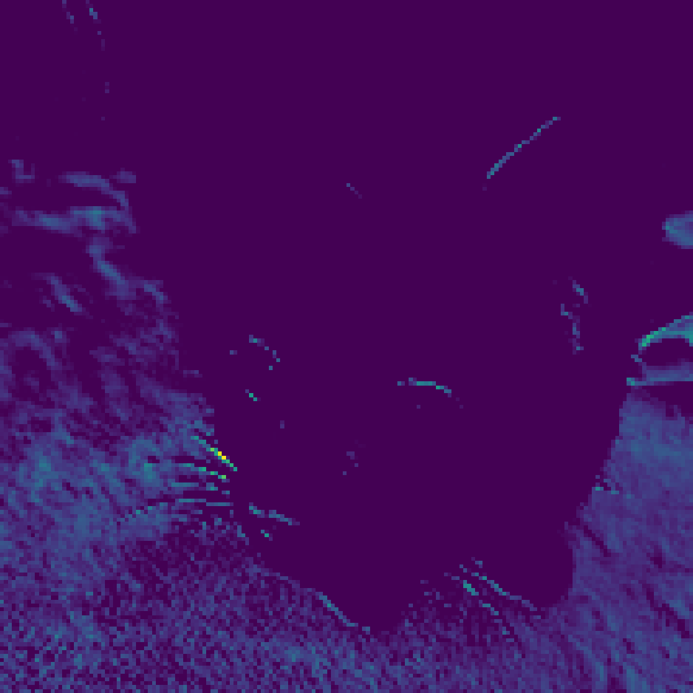
  
  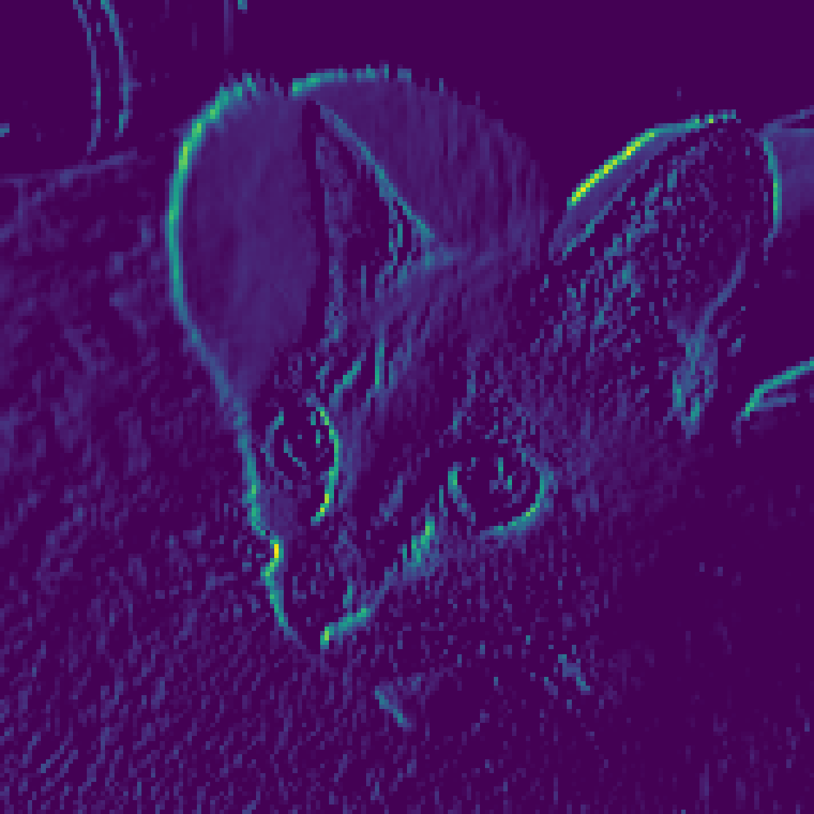
  
  
  
  
  

  
  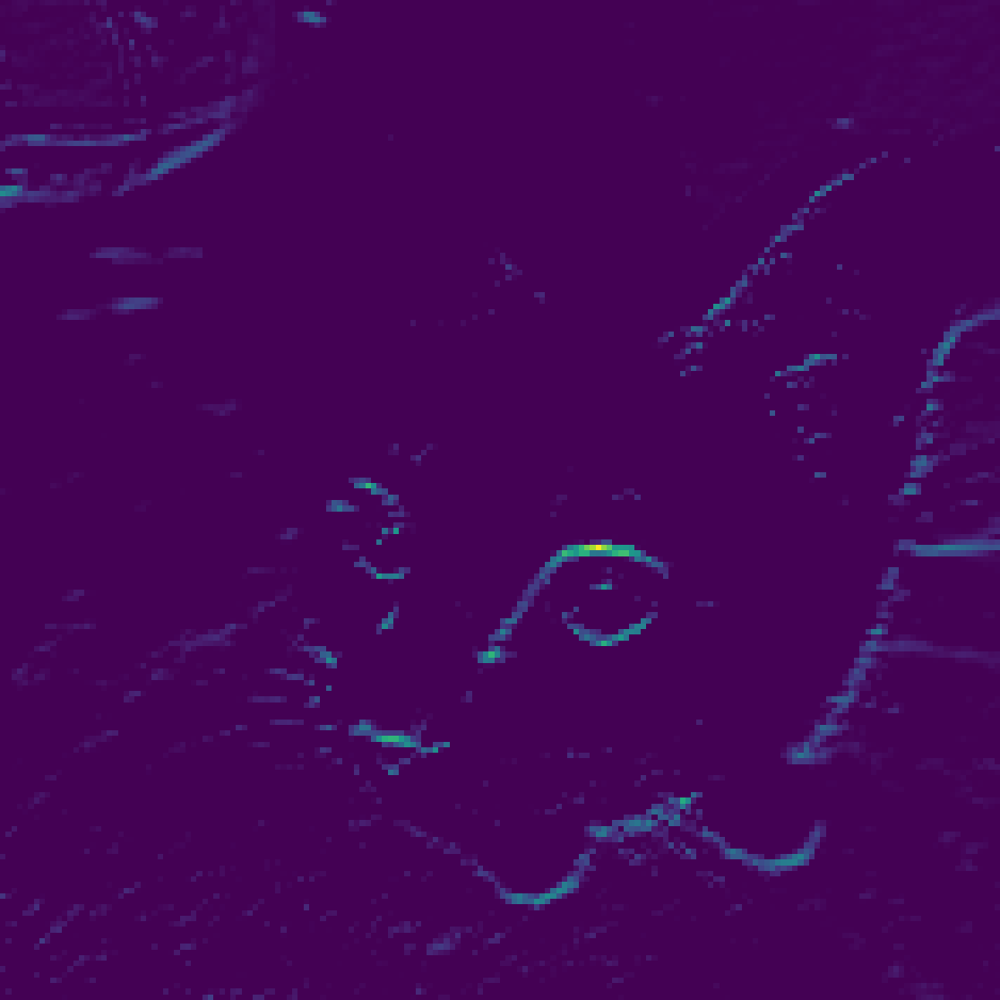
  
  
  
  
  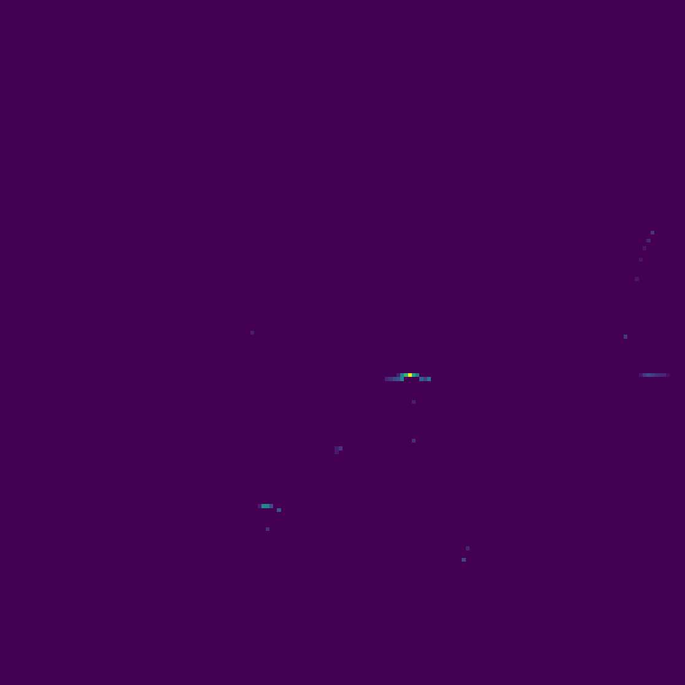
  

</div>


### Feature maps

```text
# │ conv2d (Conv2D)                      │ (None, 178, 178, 32)        │             896 │
```

**Feature map size:** `178 × 178`  
**Number of feature maps / channels:** `32`

<div style="display: flex; width: 100%;">
  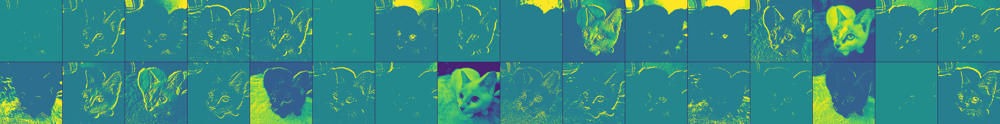
</div>

```text
# │ max_pooling2d (MaxPooling2D)         │ (None, 89, 89, 32)          │               0 │
```

**Feature map size:** `89 × 89`  
**Number of feature maps / channels:** `32`

<div style="display: flex; width: 100%;">
  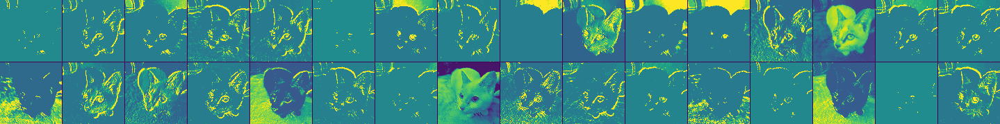
</div>

```text
# │ conv2d_1 (Conv2D)                    │ (None, 87, 87, 64)          │          18,496 │
```

**Feature map size:** `87 × 87`  
**Number of feature maps / channels:** `64`

<div style="display: flex; width: 100%;">
  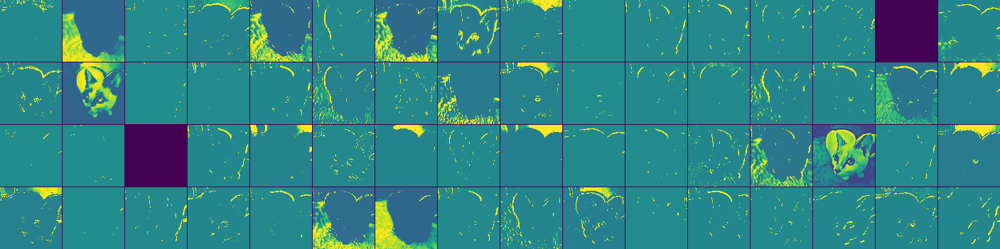
</div>

```text
# │ max_pooling2d_1 (MaxPooling2D)       │ (None, 43, 43, 64)          │               0 │
```

**Feature map size:** `43 × 43`  
**Number of feature maps / channels:** `64`

<div style="display: flex; width: 100%;">
  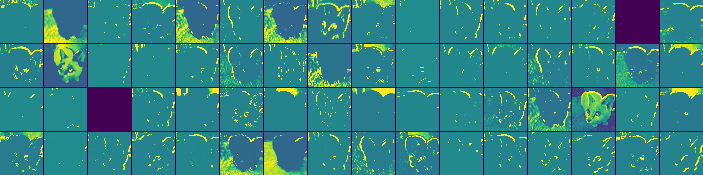
</div>

```text
# │ conv2d_2 (Conv2D)                    │ (None, 41, 41, 128)         │          73,856 │
```

**Feature map size:** `41 × 41`  
**Number of feature maps / channels:** `128`

<div style="display: flex; width: 100%;">
  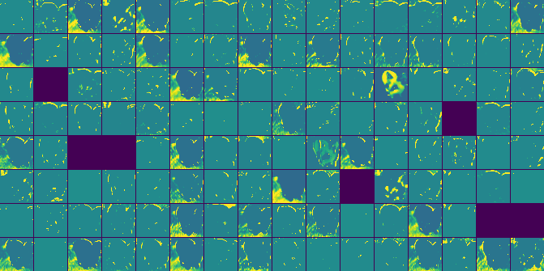
</div>

```text
# │ max_pooling2d_2 (MaxPooling2D)       │ (None, 20, 20, 128)         │               0 │
```

**Feature map size:** `20 × 20`  
**Number of feature maps / channels:** `128`

<div style="display: flex; width: 100%;">
  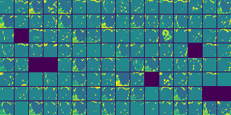
</div>

```text
# │ conv2d_3 (Conv2D)                    │ (None, 18, 18, 256)         │         295,168 │
```

**Feature map size:** `18 × 18`  
**Number of feature maps / channels:** `256`

<div style="display: flex; width: 100%;">
  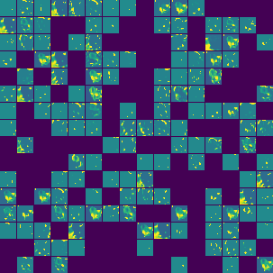
</div>

```text
# │ max_pooling2d_3 (MaxPooling2D)       │ (None, 9, 9, 256)           │               0 │
```

**Feature map size:** `9 × 9`  
**Number of feature maps / channels:** `256`

<div style="display: flex; width: 100%;">
  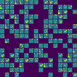
</div>

```text
# │ conv2d_4 (Conv2D)                    │ (None, 7, 7, 512)           │       1,180,160 │
```

**Feature map size:** `7 × 7`  
**Number of feature maps / channels:** `512`

<div style="display: flex; width: 100%;">
  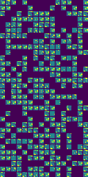
</div>

# Visualizing ConvNet filters
File ch_10_chapter10_interpreting_what_convnets_learn/02_visualizing_convnet_filters.py via gradient ascent shows how the filter is reacting based on the image:
Important part:
```python
    # Calling model(image) vs model.predict(image) is different
    # model(image) allows us to compute gradients, while model.predict(image) does not
    # Here we are calculating the loss for specific filter based on activation by the image
    # Normally we are calculating we calculate gradients dLoss/dW and using in gradient_descent calculation
    # Here we are calculating dLoss/dImage ->
    # This will allow us to determine which pixels in the image are most responsible for activating the filter
```
```python

feature_extractor.summary()
Model: "functional"
┏━━━━━━━━━━━━━━━━━━━━━━━━━━━━━━━┳━━━━━━━━━━━━━━━━━━━━━━━━━━━┳━━━━━━━━━━━━━━━━━┳━━━━━━━━━━━━━━━━━━━━━━━━━━━━┓
┃ Layer (type)                  ┃ Output Shape              ┃         Param # ┃ Connected to               ┃
┡━━━━━━━━━━━━━━━━━━━━━━━━━━━━━━━╇━━━━━━━━━━━━━━━━━━━━━━━━━━━╇━━━━━━━━━━━━━━━━━╇━━━━━━━━━━━━━━━━━━━━━━━━━━━━┩
│ input_layer (InputLayer)      │ (None, None, None, 3)     │               0 │ -                          │
├───────────────────────────────┼───────────────────────────┼─────────────────┼────────────────────────────┤
│ block1_conv1 (Conv2D)         │ (None, None, None, 32)    │             864 │ input_layer[0][0]          │
├───────────────────────────────┼───────────────────────────┼─────────────────┼────────────────────────────┤
│ block1_conv1_bn               │ (None, None, None, 32)    │             128 │ block1_conv1[0][0]         │
│ (BatchNormalization)          │                           │                 │                            │
├───────────────────────────────┼───────────────────────────┼─────────────────┼────────────────────────────┤
│ block1_conv1_act (Activation) │ (None, None, None, 32)    │               0 │ block1_conv1_bn[0][0]      │
├───────────────────────────────┼───────────────────────────┼─────────────────┼────────────────────────────┤
│ block1_conv2 (Conv2D)         │ (None, None, None, 64)    │          18,432 │ block1_conv1_act[0][0]     │
├───────────────────────────────┼───────────────────────────┼─────────────────┼────────────────────────────┤
│ block1_conv2_bn               │ (None, None, None, 64)    │             256 │ block1_conv2[0][0]         │
│ (BatchNormalization)          │                           │                 │                            │
├───────────────────────────────┼───────────────────────────┼─────────────────┼────────────────────────────┤
│ block1_conv2_act (Activation) │ (None, None, None, 64)    │               0 │ block1_conv2_bn[0][0]      │
├───────────────────────────────┼───────────────────────────┼─────────────────┼────────────────────────────┤
│ block2_sepconv1               │ (None, None, None, 128)   │           8,768 │ block1_conv2_act[0][0]     │
│ (SeparableConv2D)             │                           │                 │                            │
├───────────────────────────────┼───────────────────────────┼─────────────────┼────────────────────────────┤
│ block2_sepconv1_bn            │ (None, None, None, 128)   │             512 │ block2_sepconv1[0][0]      │
│ (BatchNormalization)          │                           │                 │                            │
├───────────────────────────────┼───────────────────────────┼─────────────────┼────────────────────────────┤
│ block2_sepconv2_act           │ (None, None, None, 128)   │               0 │ block2_sepconv1_bn[0][0]   │
│ (Activation)                  │                           │                 │                            │
├───────────────────────────────┼───────────────────────────┼─────────────────┼────────────────────────────┤
│ block2_sepconv2               │ (None, None, None, 128)   │          17,536 │ block2_sepconv2_act[0][0]  │
│ (SeparableConv2D)             │                           │                 │                            │
├───────────────────────────────┼───────────────────────────┼─────────────────┼────────────────────────────┤
│ block2_sepconv2_bn            │ (None, None, None, 128)   │             512 │ block2_sepconv2[0][0]      │
│ (BatchNormalization)          │                           │                 │                            │
├───────────────────────────────┼───────────────────────────┼─────────────────┼────────────────────────────┤
│ conv2d (Conv2D)               │ (None, None, None, 128)   │           8,192 │ block1_conv2_act[0][0]     │
├───────────────────────────────┼───────────────────────────┼─────────────────┼────────────────────────────┤
│ block2_pool (MaxPooling2D)    │ (None, None, None, 128)   │               0 │ block2_sepconv2_bn[0][0]   │
├───────────────────────────────┼───────────────────────────┼─────────────────┼────────────────────────────┤
│ batch_normalization           │ (None, None, None, 128)   │             512 │ conv2d[0][0]               │
│ (BatchNormalization)          │                           │                 │                            │
├───────────────────────────────┼───────────────────────────┼─────────────────┼────────────────────────────┤
│ add (Add)                     │ (None, None, None, 128)   │               0 │ block2_pool[0][0],         │
│                               │                           │                 │ batch_normalization[0][0]  │
├───────────────────────────────┼───────────────────────────┼─────────────────┼────────────────────────────┤
│ block3_sepconv1_act           │ (None, None, None, 128)   │               0 │ add[0][0]                  │
│ (Activation)                  │                           │                 │                            │
├───────────────────────────────┼───────────────────────────┼─────────────────┼────────────────────────────┤
│ block3_sepconv1               │ (None, None, None, 256)   │          33,920 │ block3_sepconv1_act[0][0]  │
│ (SeparableConv2D)             │                           │                 │                            │
└───────────────────────────────┴───────────────────────────┴─────────────────┴────────────────────────────┘
 Total params: 89,632 (350.12 KB)
 Trainable params: 88,672 (346.38 KB)
 Non-trainable params: 960 (3.75 KB)
```

## block3_sepconv1 (first 64 filters) react on such patterns
<div style="display: flex; width: 100%;">
  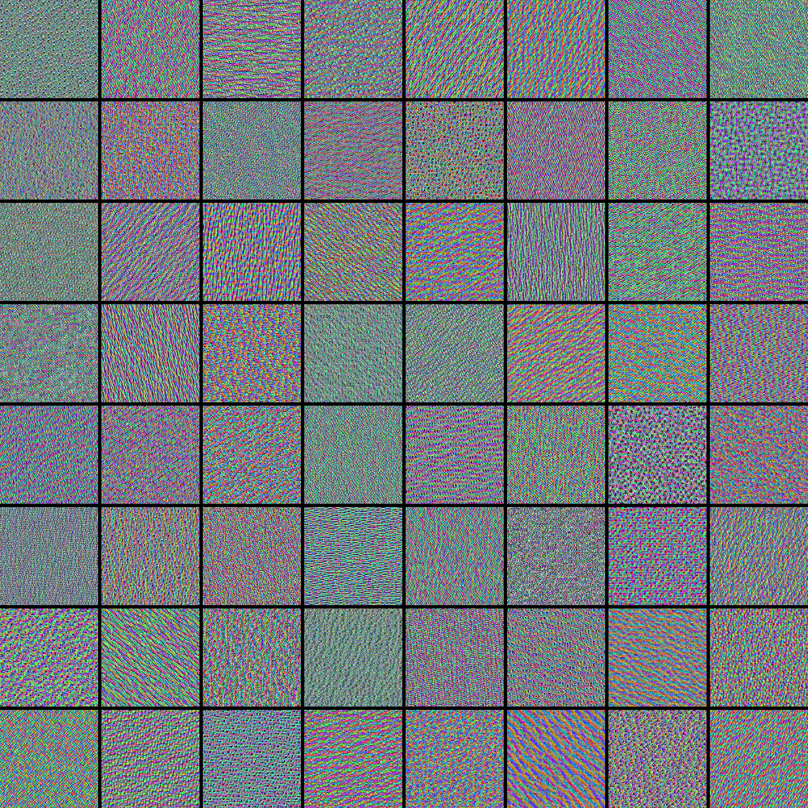
</div>

## Here are interesting patterns as well for other blocks


```md
*Source: Deep Learning with Python, François Chollet and Matthew Watson.  
Image © the authors / Manning Publications. Used here for educational reference.*
```

# Visualizing heatmaps of class activation
Which part of image is most important reg the final classification

## Original image


## Standalone class activation heatmap + African elephant class activation heatmap over the test picture
Important desctiption
```python
    # Gets the gradient of the top predicted class with regard to the
    # output feature map of the last convolutional layer
    # ---
    # Computes the gradient of the top predicted class score with respect 
    # to the output of the last convolutional layer
    # For example, if the top class is "African elephant", this computes:
    # dScore(African elephant) / dLastConvFeatureMaps
    # The gradient tells us how much each activation in the last conv feature maps
    # influences the score of the "African elephant" class
    #
    # A Grad-CAM shows which spatial regions of the input image were important for a specific class
    #
    # The process is:
    # feature maps
    # + gradients showing how important their activations are for the selected class
    # -> weighted feature maps
    # -> summation
    # -> spatial heatmap
    #
    # Example:
    # F1 * w1 = feature map 1 * 0.01   # very low importance for the selected class
    # F2 * w2 = feature map 2 * 0.80   # very high importance for the selected class
    # F3 * w3 = feature map 3 * 0.25   # moderate importance for the selected class
    #
    # Then all weighted feature maps are summed:
    # F1*w1 + F2*w2 + F3*w3 + ... -> final Grad-CAM heatmap
    #
    # A larger weight means that the corresponding feature map is more important
    # for the selected class prediction
    #
    # For example, for the "African elephant" class, the final heatmap highlights
    # the image regions that contributed the most to the "African elephant" prediction
    #
    # The gradients themselves tell us how important the feature map activations
    # are for the selected class
```
<div style="display: flex; width: 100%; gap: 10px;">
  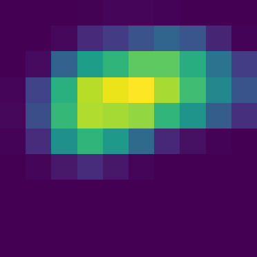
  
</div>