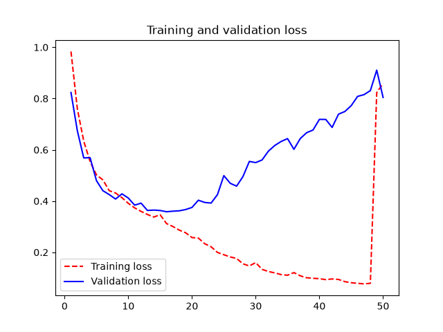
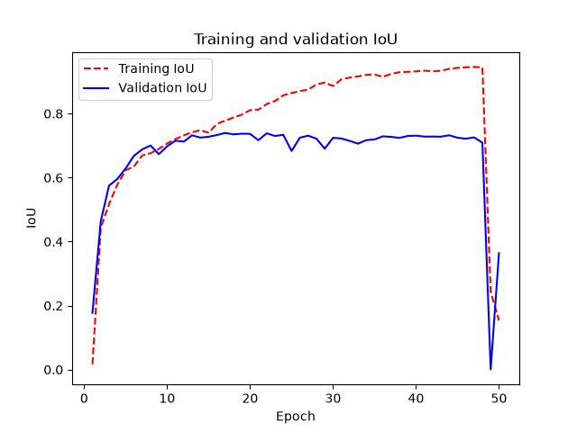
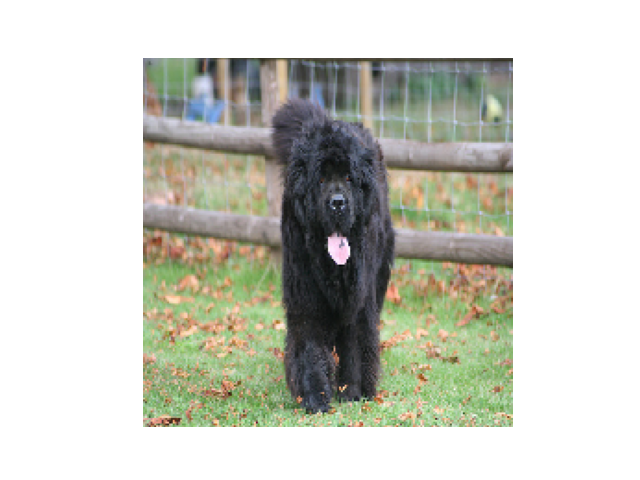
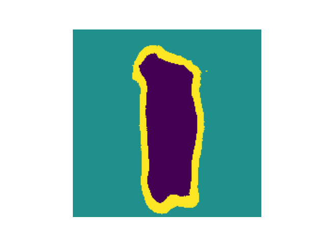

# Image segmentation own trained model
Custom model using image segmentation
- Don't use MaxPooling, here we care a lot about the spatial location of information in the image since we need to produce per-pixel target masks as output of the model
- We are interested of finding correct masks that's why for downample feature we are using strides 2
- Conv2DTranspose -> can think of it as a kind of convolution layer that learns to upsample
```python
def get_model(img_size, num_classes):
    inputs = keras.Input(shape=img_size + (3,))
    # Don't forget to rescale input images to the [0–1] range.
    x = Rescaling(1.0 / 255)(inputs)

    # We use padding="same" everywhere to avoid the influence of border
    # padding on feature map size.
    x = Conv2D(64, 3, strides=2, activation="relu", padding="same")(x)
    x = Conv2D(64, 3, activation="relu", padding="same")(x)
    x = Conv2D(128, 3, strides=2, activation="relu", padding="same")(x)
    x = Conv2D(128, 3, activation="relu", padding="same")(x)
    x = Conv2D(256, 3, strides=2, padding="same", activation="relu")(x)
    x = Conv2D(256, 3, activation="relu", padding="same")(x)

    x = Conv2DTranspose(256, 3, activation="relu", padding="same")(x)
    x = Conv2DTranspose(256, 3, strides=2, activation="relu", padding="same")(x)
    x = Conv2DTranspose(128, 3, activation="relu", padding="same")(x)
    x = Conv2DTranspose(128, 3, strides=2, activation="relu", padding="same")(x)
    x = Conv2DTranspose(64, 3, activation="relu", padding="same")(x)
    x = Conv2DTranspose(64, 3, strides=2, activation="relu", padding="same")(x)

    # We end the model with a per-pixel three-way softmax to classify
    # each output pixel into one of our three categories.
    outputs = Conv2D(num_classes, 3, activation="softmax", padding="same")(x)

    return keras.Model(inputs, outputs)
```
## Model validation loss and IoU
<div style="display: flex; width: 100%; gap: 10px;">
  
  
</div>

## Original image vs detection
<div style="display: flex; width: 100%; gap: 10px;">
  
  
</div>

# Using a pretrained segmentation model
Interesting stuff can be done using meta pretrained model -> see details in https://deeplearningwithpython.io/chapters/chapter11_image-segmentation/#using-a-pretrained-segmentation-model, for now it is skipped here

only the basic fetch done in ch_11_image_segmentation/02_segment_anything_model.py